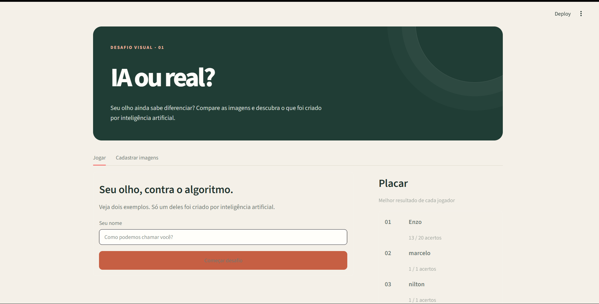

# quiz-ia-vs-real
# 🤖 IA ou Humano? - O Jogo dos Acertos

Um aplicativo interativo desenvolvido em **Python com Streamlit** onde os usuários desafiam seus olhos para adivinhar se uma imagem foi criada por Inteligência Artificial ou se é uma fotografia/arte real. Ao final do jogo, o usuário pode salvar seu nome em um **ranking global de acertos**.

---

## 🚀 Funcionalidades

- **Desafio Visual:** Exibição aleatória de imagens (geradas por IA ou reais).
- **Interface Intuitiva:** Botões simples para o usuário votar ("IA" ou "Humano").
- **Feedback em Tempo Real:** Mostra se o usuário acertou ou errou logo após o palpite.
- **Ranking Global:** Placar dinâmico que armazena o nome e a pontuação dos melhores jogadores.

---

## 🛠️ Tecnologias Utilizadas

O projeto foi construído utilizando as seguintes tecnologias:

- [Python](https://python.org) - Linguagem de programação base.
- [Streamlit](https://streamlit.io) - Framework para criação da interface web rápida e interativa.
- [Pandas](https://pydata.org) - Para manipulação e organização dos dados do ranking.

---

## 📋 Pré-requisitos

Antes de começar, você vai precisar ter instalado em sua máquina:
- **Python 3.8** ou superior.
- Gerenciador de pacotes **pip**.

---

## 🔧 Instalação e Execução

Siga os passos abaixo para rodar o projeto localmente:

1. **Clone o repositório:**
   ```bash
   git clone https://github.com
   cd nome-do-repositorio
   ```

2. **Crie um ambiente virtual (opcional, mas recomendado):**
   ```bash
   python -m venv venv
   # No Windows:
   venv\Scripts\activate
   # No Linux/macOS:
   source venv/bin/activate
   ```

3. **Instale as dependências:**
   ```bash
   pip install -r requirements.txt
   ```
   *(Caso não tenha o arquivo `requirements.txt`, instale manualmente: `pip install streamlit pandas`)*

4. **Execute a aplicação:**
   ```bash
   streamlit run app.py
   ```

---

## 📂 Estrutura do Projeto

```text
├── assets/               # Pasta com as imagens do jogo
│   ├── ia/               # Imagens geradas por inteligência artificial
│   └── real/             # Imagens reais / humanas
├── ranking.csv           # Arquivo onde os dados do placar são salvos
├── app.py                # Código principal do aplicativo Streamlit
├── requirements.txt      # Dependências do projeto
└── README.md             # Documentação do projeto
```

---

## 💡 Como Jogar?

1. Acesse o link local gerado pelo Streamlit no seu navegador.
2. Analise a imagem exibida na tela.
3. Clique em **"Foi gerada por IA"** ou **"É Real"**.
4. Avance pelas perguntas até o final do quiz.
5. Digite seu **nome** no campo indicado para salvar sua pontuação no ranking!

---

## 📄 Licença

Este projeto está sob a licença MIT. Veja o arquivo [LICENSE](LICENSE) para mais detalhes.

---

## Capturas de tela

### Tela inicial




Feito com 🧠 e 🐍 por marcelo 
